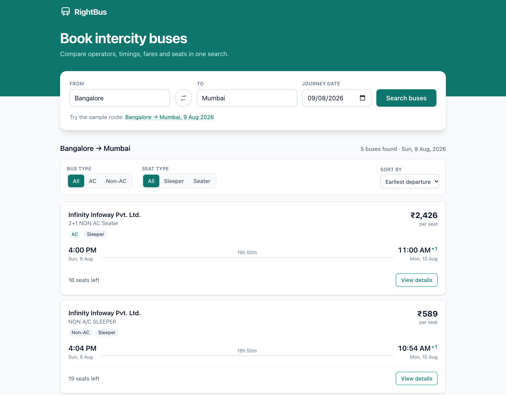
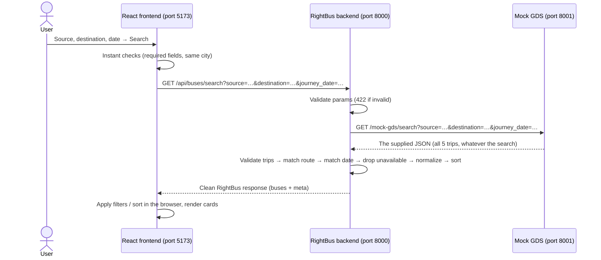
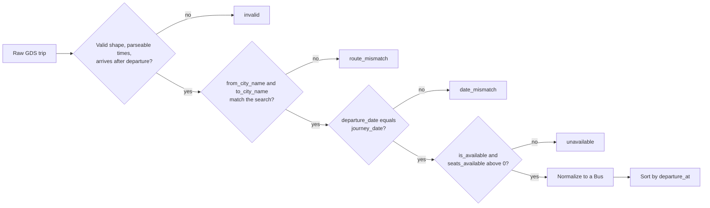

# RightBus · Full-Stack Bus Search

A small bus search module: enter a source, destination and journey date, and see
the buses that really run on that route, with filters, sorting and a details view.

**React frontend → RightBus backend (FastAPI) → Mock GDS API (FastAPI) → supplied hardcoded JSON**



## Contents

- [What's included](#whats-included)
- [Architecture and API flow](#architecture-and-api-flow)
- [Tech stack](#tech-stack)
- [Getting started](#getting-started)
- [API reference](#api-reference)
- [How the mock GDS works](#how-the-mock-gds-works)
- [How filtering works](#how-filtering-works)
- [Frontend](#frontend)
- [Testing](#testing)
- [Design decisions](#design-decisions)
- [AI usage](#ai-usage)
- [What I'd do next](#what-id-do-next)

## What's included

| Assignment requirement | Where |
|---|---|
| Mock GDS `GET /mock-gds/search` returning the supplied JSON | [`backend/mock_gds/main.py`](backend/mock_gds/main.py), data in [`gds_response.json`](backend/mock_gds/gds_response.json) |
| Backend `GET /api/buses/search` that calls the mock GDS | [`backend/app/routes.py`](backend/app/routes.py), [`gds_client.py`](backend/app/gds_client.py) |
| Validate params; match on `from_city_name`/`to_city_name`; match the date; drop unavailable trips; clean response | [`backend/app/schemas.py`](backend/app/schemas.py), [`search_service.py`](backend/app/search_service.py) |
| Don't trust `route_name` | Matching never reads it; mismatches are flagged as data warnings |
| Search page with results (operator, bus type, times, duration, AC, seat type, seats, fare) | [`frontend/src/components`](frontend/src/components) |
| Loading, results, no-results and API-error states | [`frontend/src/components/states`](frontend/src/components/states) |
| At least two filters/sorts | All four: AC/Non-AC, Sleeper/Seater, price low→high, earliest departure |
| View Details with boarding and dropping points | [`BusDetailsModal.jsx`](frontend/src/components/BusDetailsModal.jsx) |
| ≥5 backend tests including the five named cases, ≥2 frontend scenarios | 65 backend tests, 27 frontend tests ([Testing](#testing)) |

## Architecture and API flow

Three processes. The frontend only ever calls the RightBus backend; it doesn't know
the mock GDS exists. In development the Vite dev server proxies `/api` to the
backend, and the mock GDS sends no CORS headers, so a browser couldn't call it directly
even if it tried.



Inside the backend each layer has one job:

| File | Responsibility |
|---|---|
| `routes.py` | HTTP only: parses query params into `SearchParams`, calls the service |
| `schemas.py` | Validation rules (input), the provider contract (inbound), the response shape (outbound) |
| `gds_client.py` | Calls the GDS with a timeout; turns every failure into a clear app error |
| `search_service.py` | The search logic as a pure function `process_trips()`, easy to unit-test |
| `errors.py` | One JSON error shape for every failure |
| `utils.py` | City normalization, 12-hour time parsing, contact cleanup |

## Tech stack

| Layer | Choice | Why |
|---|---|---|
| Mock GDS | Python + FastAPI | Recommended by the assignment. Runs as its own service so the backend integrates with it like a real third-party API. |
| Backend | FastAPI, Pydantic v2, httpx (async), pydantic-settings | Declarative validation, automatic OpenAPI docs, async HTTP with timeouts and a pooled client. No database is needed for a read-only search, so Django's ORM/admin would go unused. |
| Frontend | React 19 (JavaScript), Vite 8, Tailwind CSS 4 | Fast dev server with an `/api` proxy, no CSS files to maintain, small bundle. |
| Tests | pytest, FastAPI TestClient, httpx `ASGITransport`/`MockTransport`; Vitest + React Testing Library | Every test runs in-process: no servers to start. |
| Tooling | Ruff (Python lint + format), oxlint (Vite's default linter), Makefile | One command each to install, run, test and lint. |

## Getting started

**Prerequisites:** Python 3.11+ and Node.js 22.12+ (developed with Python 3.13 and Node 22.21). No API keys or secrets are needed.

### Quick start (macOS / Linux)

```bash
make install   # creates backend/.venv and installs Python + npm dependencies
make dev       # starts mock GDS :8001, backend :8000 and frontend :5173 together
```

Open **http://localhost:5173** and click **"Bangalore → Mumbai, 9 Aug 2026"** to run the
sample search. `make help` lists every command.

### Manual setup (any OS, three terminals)

```bash
# Backend dependencies (once)
cd backend
python3 -m venv .venv
source .venv/bin/activate          # Windows: .venv\Scripts\activate
pip install -r requirements-dev.txt

# Terminal 1 — mock GDS on :8001 (from backend/, venv active)
uvicorn mock_gds.main:app --port 8001 --reload

# Terminal 2 — RightBus backend on :8000 (from backend/, venv active)
uvicorn app.main:app --port 8000 --reload

# Terminal 3 — frontend on :5173
cd frontend
npm install
npm run dev
```

Interactive API docs: backend at http://localhost:8000/docs, mock GDS at http://localhost:8001/docs.

### Configuration

Everything has a working default. To override, copy [`backend/.env.example`](backend/.env.example) to `backend/.env`.

| Variable | Default | Used by | Purpose |
|---|---|---|---|
| `GDS_BASE_URL` | `http://127.0.0.1:8001` | backend | Where the GDS lives |
| `GDS_TIMEOUT_SECONDS` | `5` | backend | Give up on the GDS after this long (→ 504) |
| `CORS_ORIGINS` | `http://localhost:5173,http://127.0.0.1:5173` | backend | Browser origins allowed to call the API |
| `ALLOW_PAST_DATES` | `true` | backend | See [data observation 5](#data-observations) |
| `MOCK_GDS_LATENCY_MS` | `0` | mock GDS | Slow every response down, to see the loading state |
| `MOCK_GDS_FAIL_MODE` | `none` | mock GDS | `error`, `timeout` or `malformed`, to see the error state |
| `VITE_API_BASE_URL` | empty (same origin) | frontend | Call a backend on another origin instead of the proxy |

The `MOCK_GDS_*` knobs are read from the mock GDS process's environment, e.g. `MOCK_GDS_FAIL_MODE=error make mock-gds`.

## API reference

### `GET /api/buses/search` (RightBus backend, :8000)

| Query param | Required | Rules |
|---|---|---|
| `source` | yes | 1–60 characters after trimming |
| `destination` | yes | 1–60 characters; must be a different city from `source` (case, spacing and aliases like Bengaluru/Bangalore are ignored) |
| `journey_date` | yes | `YYYY-MM-DD` and a real calendar date |

```bash
curl "http://localhost:8000/api/buses/search?source=Bangalore&destination=Mumbai&journey_date=2026-08-09"
```

`200 OK` (one bus shown, boarding/dropping lists shortened):

```json
{
  "source": "Bangalore",
  "destination": "Mumbai",
  "journey_date": "2026-08-09",
  "total_results": 5,
  "buses": [
    {
      "trip_id": "TRP-128475",
      "operator": "Infinity Infoway Pvt. Ltd.",
      "bus_type": "2+1 NON AC Seater",
      "is_ac": true,
      "seat_type": "sleeper",
      "departure_at": "2026-08-09T16:00:00",
      "arrival_at": "2026-08-10T11:00:00",
      "duration_minutes": 1140,
      "fare": 2426,
      "currency": "INR",
      "seats_available": 16,
      "amenities": ["Reading Light", "AC"],
      "boarding_points": [
        { "name": "Bannerghatta Road", "time": "3:00 PM", "contact": "08022377777", "distance_km": 12.11, "is_nearest": true }
      ],
      "dropping_points": [
        { "name": "Sion Circle - Bank Of India", "time": "11:00 AM", "contact": null, "distance_km": 15.35, "is_nearest": true }
      ],
      "cancellation_policy": { "is_cancellable": true, "reschedule_allowed": true, "reschedule_charge": 0 },
      "data_warnings": [
        { "code": "BUS_TYPE_AC_CONFLICT", "message": "Bus type label '2+1 NON AC Seater' disagrees with the AC flag; shown as AC." },
        { "code": "BUS_TYPE_SEAT_CONFLICT", "message": "Bus type label '2+1 NON AC Seater' says seater, but the seat type field says sleeper; shown as sleeper." }
      ]
    }
  ],
  "meta": {
    "provider_trip_count": 5,
    "excluded": { "route_mismatch": 0, "date_mismatch": 0, "unavailable": 0, "invalid": 0 }
  }
}
```

- `departure_at` / `arrival_at` are local ISO datetimes, built from the provider's separate date and "4:00 PM" fields. They sort correctly and need no parsing on the client.
- `fare` is the provider's `total_fare` (base fare + tax + surcharges).
- `meta.excluded` says how many provider trips were dropped and why, which makes the filtering visible and easy to debug.
- Left out on purpose: `booking_token` (internal provider IDs), `proximity_info` (duplicates `is_nearest`) and `route_name` (unreliable).

**Errors** all share one shape, so the frontend handles them in one place:

```json
{ "error": { "code": "VALIDATION_ERROR", "message": "source is required", "details": [{ "field": "source", "message": "source is required" }] } }
```

| Status | `code` | When |
|---|---|---|
| 200 | – | A valid search, even with **no** matching buses (`buses: []`) |
| 422 | `VALIDATION_ERROR` | Missing/blank source or destination, bad `journey_date`, same city, or a past date when `ALLOW_PAST_DATES=false` |
| 502 | `GDS_UNAVAILABLE` | The GDS can't be reached (connection refused, DNS…) |
| 502 | `GDS_BAD_RESPONSE` | The GDS answered with a non-200, invalid JSON, `status` ≠ `success`, or no `trips` list |
| 504 | `GDS_TIMEOUT` | The GDS took longer than `GDS_TIMEOUT_SECONDS` |
| 404 | `NOT_FOUND` | Unknown URL |

422 is FastAPI's native status for validation errors; only the body is reshaped into friendlier messages.

### Other endpoints

| Service | Endpoint | Returns |
|---|---|---|
| Mock GDS | `GET /mock-gds/search?source=&destination=&journey_date=` | The supplied JSON (422 if a param is missing) |
| Both | `GET /health` | `{"status": "ok"}` |

## How the mock GDS works

[`mock_gds/main.py`](backend/mock_gds/main.py) is a separate FastAPI app. It requires the
three search params, as a real provider would, then returns the hardcoded response
**unchanged, whatever the values**. That's deliberate:

- The data says `"search_mode": "coordinates"`, and its `resolved_source_stops` include
  places like "Vellore (Chennai)" and "Heidelberg". A coordinate-based provider search
  over-returns nearby trips, so the consumer has to decide what really matches.
- If the mock filtered, the backend's filtering would never be exercised against
  realistic noise. Owning correctness in the backend is the point of the exercise.

The JSON file is the assignment's Appendix A, extracted from the PDF. As an integrity
check, every trip's `booking_token` was base64-decoded and its `route_time_id`
matched against the trip ID. It is loaded once and cached.

## How filtering works

[`process_trips()`](backend/app/search_service.py) takes the raw provider trips and the
validated search, and returns the matching buses plus exclusion counts. Each trip goes
through these checks in order; the first failure decides why it was dropped:



1. **Validate** each trip against `GdsTrip`. A malformed trip is skipped and logged; one bad record never fails the whole search.
2. **Route:** compare `normalize_city(from_city_name/to_city_name)` with the search. Normalizing means trimming, single spaces, ignoring case, and resolving aliases (Bengaluru → Bangalore, Bombay → Mumbai, …). **`route_name` is never used.**
3. **Date:** `schedule.departure_date` must equal `journey_date`.
4. **Availability:** `is_available` must be true **and** `seats_available > 0`. A trip that claims to be available with no seats isn't bookable.
5. **Normalize:**
   - Times like "4:00 PM" and "01:30 PM" become datetimes.
   - Seat type comes from `bus_seat_type`; AC comes from `is_ac`.
   - Placeholder contacts like `"0"` become `null`.
6. **Sort** on the real departure datetime. Sorting the text would put "11:03 PM" before "4:00 PM".

Every search logs one line, e.g.
`search Bangalore -> Mumbai on 2026-08-09: provider_trips=5 kept=5 excluded={...} gds_ms=3`.

### Data observations

The supplied data has several traps. How each one is handled:

1. **`route_name` is unreliable** (called out in the assignment). TRP-120807 and TRP-130024 say "Bangalore To Jaisalmer" and TRP-128852 says "Bangalore To Jodhpur…", yet all three are Bangalore → Mumbai by their city fields. They're included in results and flagged with `ROUTE_NAME_MISMATCH`.
2. **A second, unmentioned contradiction.** TRP-128475's `bus_type` says "2+1 NON AC **Seater**". But `is_ac` is `true`, its amenities list "AC", and `bus_seat_type`, `fare_type` and `seat_types` all say sleeper. Following the same principle as (1), the structured fields win: it shows as **AC Sleeper**, filters that way, and carries `BUS_TYPE_AC_CONFLICT` and `BUS_TYPE_SEAT_CONFLICT` warnings. The details view shows these as "Provider data notes".
3. **Mixed time formats:** "01:30 PM" and "1:30 PM" both appear. The parser accepts both, and output is always "1:30 PM".
4. **Every supplied trip is available**, so the unavailable/sold-out rule is proven with synthetic trips in the tests.
5. **The dataset date is in the past.** Trips depart 2026-08-09, which is before this was built (October 2026). Rejecting past dates, as a production search would, would block the assignment's own example. So past-date rejection is opt-in (`ALLOW_PAST_DATES=false`, with a test), and the date picker has no minimum date.
6. **Placeholder contact numbers** (`"0"`) are dropped, and comma-separated numbers are tidied.

## Frontend

| State | When | Screenshot |
|---|---|---|
| Idle | Before the first search | [home.png](docs/screenshots/home.png) |
| Inline validation | Missing fields or same city: caught before calling the API | [validation.png](docs/screenshots/validation.png) |
| Loading | Request in flight: skeleton cards, button disabled | [loading.png](docs/screenshots/loading.png) |
| Results | Buses found | [search-results.png](docs/screenshots/search-results.png) |
| Filtered | Filters/sort applied, "Showing 2 of 5" | [filters-and-sort.png](docs/screenshots/filters-and-sort.png) |
| No results | Valid search, no buses (e.g. Bangalore → Delhi) | [no-results.png](docs/screenshots/no-results.png) |
| Filtered to nothing | e.g. "Seater": explains and offers "Show all buses" | covered by tests |
| Error | Backend or GDS failure: the backend's message, a retry button, and the error code | [error.png](docs/screenshots/error.png) |
| Details | Boarding/dropping points, amenities, cancellation, data notes | [bus-details.png](docs/screenshots/bus-details.png) |
| Mobile | Works down to 375 px | [mobile.png](docs/screenshots/mobile.png) |

- **Filters and sorting** run in the browser on the fetched list, so they're instant and need no new request. The split of responsibility: the backend decides *which buses are valid* for a search, and the frontend decides *how to show them*. With pagination over thousands of trips, these would move to backend query params.
- **Race conditions:** each search aborts the previous request (`AbortController` in [`useBusSearch.js`](frontend/src/hooks/useBusSearch.js)), so a slow old response can't overwrite newer results.
- **Shareable searches:** the search is mirrored in the URL (`?source=…&destination=…&date=…`), so a refresh or a shared link re-runs it.
- **Times:** shown from the ISO strings without timezone conversion. A bus leaving Bangalore at 4 PM reads 4:00 PM wherever the user is. The "+1" marks next-day arrival.
- **Accessibility:**
  - Labelled inputs with linked error messages.
  - `aria-pressed` on filter toggles.
  - An `aria-live` results count.
  - A native `<dialog>` for details: focus trap and Esc to close come free, and focus returns to the "View details" button afterwards.

## Testing

```bash
make test                          # everything
cd backend && .venv/bin/pytest -v  # backend only (65 tests)
cd frontend && npm test            # frontend only (27 tests)
make lint                          # ruff + oxlint
```

### Backend (pytest, 65 tests)

API tests run the backend against the **real mock GDS app in-process** via httpx's
`ASGITransport`, so they cover the full path (route → GDS client → mock GDS → JSON file)
with no servers running. Provider failures are simulated with `httpx.MockTransport`.

| Area | Tests |
|---|---|
| **The five required cases** | Bangalore→Mumbai returns all 5 trips, including the 3 with misleading route names; Bangalore→Delhi returns 200 with `[]`; missing source → 422; missing destination → 422; same source and destination → 422, also for `" bangalore "` vs `"BANGALORE"` and Bengaluru vs Bangalore |
| Validation | Blank source, missing date, bad dates (`09-08-2026`, `2026-02-30`, `tomorrow`, `2026-8-9`), strict past-date mode |
| Matching | Other dates → none; reverse direction → none; case, spacing and aliases tolerated; sorted by real departure time; clean fields and hidden provider internals |
| Pipeline unit tests ([`test_search_service.py`](backend/tests/test_search_service.py)) | Unavailable and sold-out trips dropped; a "Bangalore To Mumbai" route name that really goes to Delhi is excluded; malformed trips skipped; label conflicts and misleading route names flagged |
| Provider failures ([`test_gds_errors.py`](backend/tests/test_gds_errors.py)) | Connection refused → 502, timeout → 504, HTTP 500 / non-JSON / `status: error` / no trips → 502 |
| Mock GDS | Returns the file verbatim, ignores search values, requires all params, fail modes |
| Helpers | 12-hour time parsing edge cases (12 AM/PM, leading zeros, garbage), city normalization, contact cleanup |

### Frontend (Vitest + React Testing Library, 27 tests)

[`App.test.jsx`](frontend/src/test/App.test.jsx) drives the whole page like a user, with
`fetch` mocked and a **real backend response** as the fixture. Scenarios:

1. A successful search shows 5 cards, the summary, the right API URL, and updates the address bar.
2. The loading state appears while the request is pending.
3. "No buses found" for a route with no service.
4. A provider failure shows the error, and **Try again** recovers.
5. A same-city search is blocked before any API call.
6. AC filter → 2 cards; price sort → ₹589 … ₹7,392; Seater → "No buses match these filters" → "Show all buses". All with a single API call.
7. View details lists boarding and dropping points and the data notes; the close button closes it.
8. Opening a shared link runs its search.

Unit tests cover the pure filter/sort functions, the formatters (₹ with Indian digit
grouping, 12-hour times, dates without timezone shifts) and how the API client maps
network failures, error envelopes and aborts.

## Design decisions

| Decision | Why |
|---|---|
| Mock GDS as a separate service that doesn't filter | Mirrors a real coordinate-based provider; makes the backend responsible for correctness and lets it be tested against noisy data. |
| Trust structured fields over free text | `route_name` and `bus_type` labels contradict the structured fields; the structured ones are consistent with each other. Contradictions are surfaced as warnings, not hidden. |
| Pure `process_trips()` | No I/O, so every rule is unit-tested with hand-made trips in milliseconds. |
| Skip-and-count malformed trips | One bad record from a provider shouldn't take the whole search down; `meta.excluded.invalid` keeps it visible. |
| 200 + empty list for "no buses" | It's a successful search with zero results, not an error. The UI shows a helpful empty state. |
| Dedicated 502/504 codes | The frontend can say "our bus partner isn't responding" instead of a generic error. |
| One shared `httpx.AsyncClient` | Created at startup in FastAPI's lifespan, so connections to the GDS are pooled. |
| Boarding/dropping points inside each bus | The assignment asks for details "from the API response"; View Details needs no second request. A large catalogue would lazy-load them. |
| No database, auth, Redux or React Router | A read-only search over one provider response doesn't need them. |

## AI usage

This project was built with an AI coding assistant (Claude Code), which the assignment
allows and encourages. It helped write the code, tests and documentation. The design
decisions and their reasoning are written down in this README and in code comments, and
the behaviour is checked by the 92 automated tests and by running the app as described
above.

## What I'd do next

- **Multiple providers:** a provider interface/adapter per GDS, calling them concurrently and de-duplicating results.
- **Resilience:** retries with backoff, a circuit breaker for a failing provider, and a short-TTL cache for repeated searches.
- **Scale:** server-side filters, sorting and pagination as query params once results get large.
- **Booking flow:** seat layout and selection, with the `booking_token` kept server-side and keyed by `trip_id`.
- **Ops:** Docker Compose, CI running both test suites, structured logs with request IDs, and an end-to-end Playwright test.
